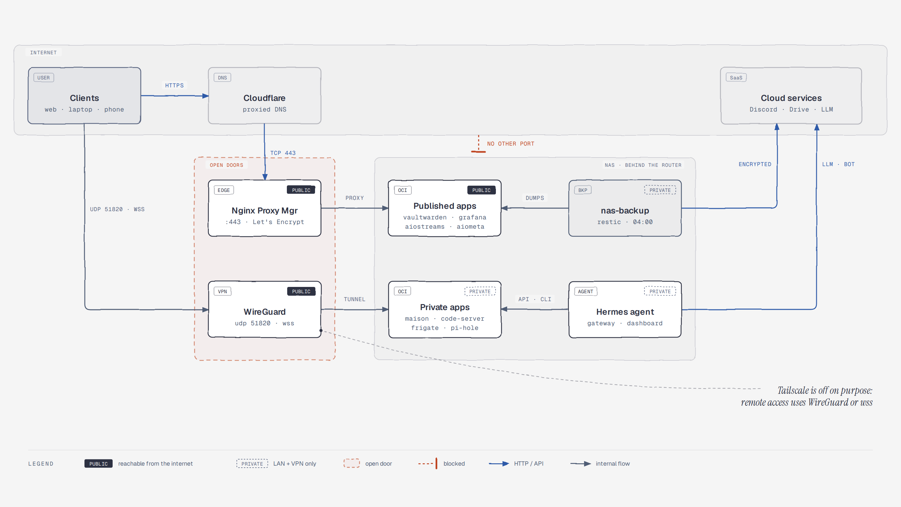
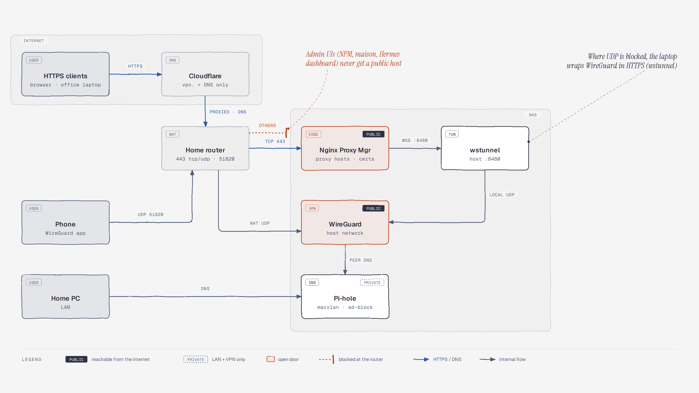
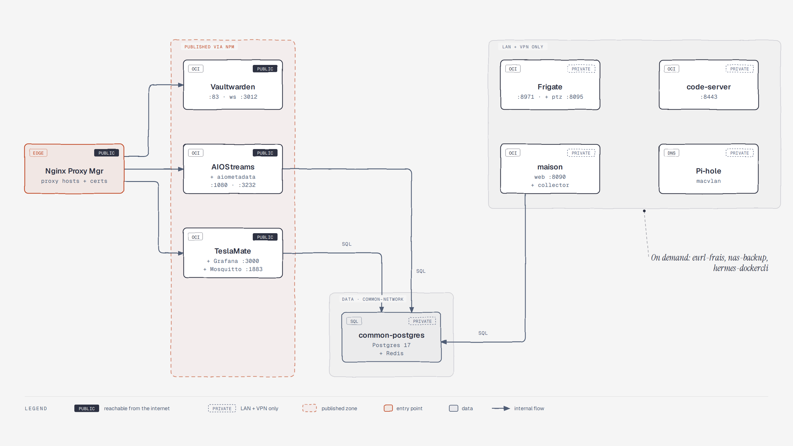
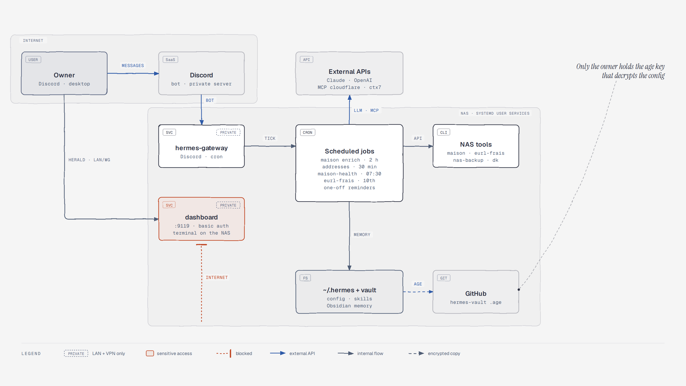
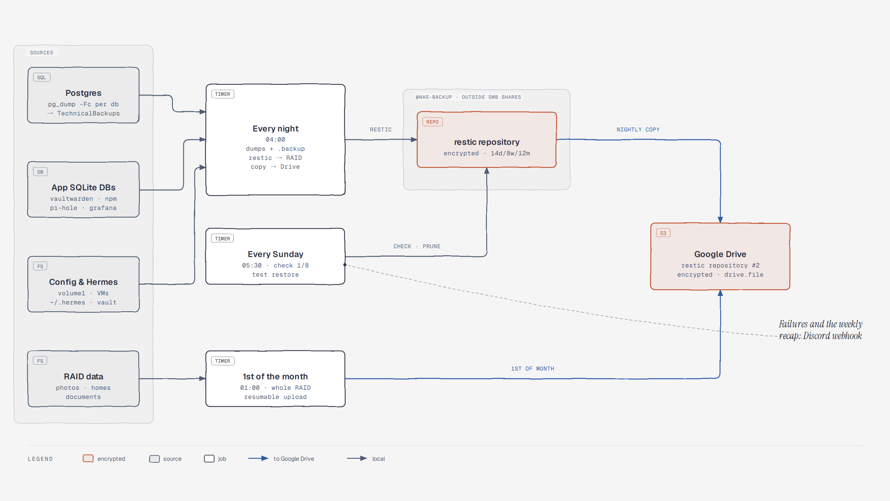
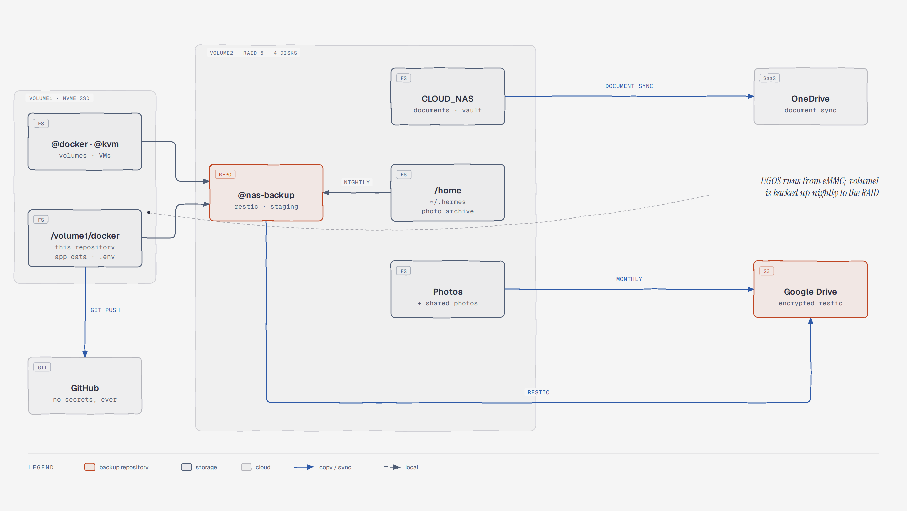

# Home server

This repository holds the Docker stacks, backup jobs, and agent configuration
of a UGREEN NAS. Each stack is a folder with its own `docker-compose.yaml` and
git-ignored `.env`, and the stacks share one PostgreSQL server. A Hermes agent
runs on the host, drives some of the services, and reports on Discord.

To rebuild everything after an OS reset or a NAS swap, follow
[`REBUILD.md`](REBUILD.md).

## Infrastructure at a glance

The six diagrams below show what runs on the NAS and what the internet can
reach. A black **PUBLIC** badge marks a service reachable from the internet,
and a dashed **PRIVATE** badge marks a service kept to the LAN and the VPN.
Orange marks open doors and blocked paths.

<!-- prettier-ignore -->
> [!NOTE]
> These are public versions: they leave out LAN addresses, VPN peers, and
> known weak spots. Open
> [`docs/diagrams/infrastructure.html`](docs/diagrams/infrastructure.html)
> locally for the interactive page, or regenerate the images as described in
> [`docs/diagrams/README.md`](docs/diagrams/README.md).

### Overview

Only two doors are open to the internet: Nginx Proxy Manager behind Cloudflare,
and WireGuard. Everything else, including the Hermes agent and the backups,
stays behind the router.



<details>
<summary>Detail diagrams: network access, containers, Hermes, backups, and storage</summary>

#### Network access

HTTPS goes through Cloudflare and the router to Nginx Proxy Manager. A phone
connects to WireGuard directly. From a network that blocks UDP, a laptop wraps
WireGuard in HTTPS through wstunnel.



#### Containers

The running containers, grouped by who can reach them.



#### Hermes agent

What talks to the Hermes agent, and what the agent drives.



#### Backups

Everything that leaves the NAS for backup is encrypted by restic.



#### Storage

Where the data lives, and how it leaves the NAS.



</details>

## Repository layout

Each top-level folder is one unit you can start, back up, or rebuild on its
own.

```
docker/
├── common/        Shared PostgreSQL 17 and Redis
├── home-server/   Reverse proxy, DNS, VPN, passwords, streaming, cameras
├── teslamate/     Tesla tracking with Grafana dashboards
├── maison/        Private house-search crawler and UI (LAN and VPN only)
├── eurl-frais/    Monthly company-expenses CLI, run by a Hermes job
├── backup/        Encrypted restic backups to the RAID and Google Drive
├── boot-check/    Post-reboot health check with a Discord verdict
├── hermes-vault/  Encrypted configuration of the Hermes agent
└── docs/          Infrastructure diagrams and their generator
```

## Stacks

These tables list each stack's services with the host port they publish. Every
port is reachable from the LAN and the VPN; only the services behind Nginx
Proxy Manager are reachable from the internet.

### Common (`common/`)

The shared data layer. Other stacks join the `common-network` network to reach
it.

| Service | Container | Image | Host port |
|---|---|---|---|
| PostgreSQL 17 | `common-postgres` | `postgres:17` | 5000 (to 5432) |
| Redis | `common-redis` | `redis` | none |

### Home server (`home-server/`)

The core services: reverse proxy, DNS, VPN, passwords, streaming add-ons, and
cameras.

| Service | Image | Port | Notes |
|---|---|---|---|
| Nginx Proxy Manager | `jc21/nginx-proxy-manager` | 80, 81, 443 | Reverse proxy and Let's Encrypt certificates |
| Pi-hole | `pihole/pihole` | 8080 (web) | DNS ad-blocking, macvlan address |
| Vaultwarden | `vaultwarden/server` | 83, 3012 | Bitwarden-compatible password manager |
| WireGuard | `linuxserver/wireguard` | 51820/udp | VPN, **host** network mode |
| wstunnel | `erebe/wstunnel` | 8480 | WireGuard over WebSocket/TLS, behind NPM |
| AIOStreams | `viren070/aiostreams` | 1080 | Stremio add-on aggregator |
| AIOMetadata | `cedya77/aiometadata` | 3232 | Stremio metadata add-on |
| StremThru | `muniftanjim/stremthru` | none | Debrid API gateway for AIOStreams, internal only |
| Frigate | `blakeblackshear/frigate` | 8971 | NVR; needs `/dev/dri/renderD128` |
| PTZ preset | `python:3.12-alpine` | 8095 | Named camera positions for Home Assistant |

To reach the NAS from a network that blocks UDP, see
[`home-server/wstunnel/README.md`](home-server/wstunnel/README.md).

### TeslaMate (`teslamate/`)

Vehicle tracking. TeslaMate stores its data in `common-postgres`.

| Service | Image | Port |
|---|---|---|
| TeslaMate | `teslamate/teslamate` | 4000 |
| Grafana | `teslamate/grafana` | 3000 |
| Mosquitto | `eclipse-mosquitto:2` | 1883 |

### Maison (`maison/`)

A private house-search crawler with a web UI on port 8090, LAN and VPN only.
The `web` and `collector` services share one image. See
[`maison/README.md`](maison/README.md).

### EURL expenses (`eurl-frais/`)

A one-shot CLI container with no port. A Hermes job runs it on the 10th of each
month. It mounts only two folders of the company directory, set by
`EURL_CLOUD_DIR` in its `.env`. See [`eurl-frais/README.md`](eurl-frais/README.md).

## Networking

The stacks use three Docker networks, plus the host network for the VPN.

| Network | Type | Purpose |
|---|---|---|
| `common-network` | bridge | Database access across stacks |
| `home-server-network` | bridge (IPv4 and IPv6) | Internal service communication |
| `macvlan_net` | macvlan (`bridge0`) | LAN-visible containers (Pi-hole) |

A macvlan child can't reach its parent's own IP stack, and `bridge0` is also
the NAS's LAN interface. This has two consequences:

- WireGuard runs in **host** network mode, not macvlan. On macvlan, the VPN
  could reach the entire LAN except the NAS itself.
- The NAS needs a macvlan shim to reach Pi-hole. It's installed as a systemd
  unit; see [`REBUILD.md`](REBUILD.md).

## Hermes agent

The Hermes agent runs on the host, not in Docker, as two systemd user services:
`hermes-gateway` (Discord bot and scheduled jobs) and `hermes-dashboard` (web
UI on port 9119, LAN and VPN only). Its scheduled jobs enrich the `maison`
listings, check the `maison` stack every morning, and run `eurl-frais` every
month.

The agent's configuration is sealed with age in
[`hermes-vault/`](hermes-vault/README.md). Its secrets and conversation history
are in the restic backups, not in git.

<!-- prettier-ignore -->
> [!CAUTION]
> The dashboard gives terminal access to the NAS. Never publish it through
> Nginx Proxy Manager without an access policy in front of it.

## Configuration

Secrets live in git-ignored `.env` files, one per stack.

| File | Variables |
|---|---|
| `common/.env` | `POSTGRES_USER`, `POSTGRES_PASSWORD`, `POSTGRES_DB` |
| `home-server/.env` | `PIHOLE_WEBPASSWORD`, `FRIGATE_RTSP_PASSWORD`, `PTZ_CAMERA_USER`, `PTZ_API_TOKEN`, `WSTUNNEL_PATH_PREFIX` |
| `home-server/aiostreams/.env` | `BASE_URL`, `SECRET_KEY`, `DATABASE_URI`, `BUILTIN_STREMTHRU_URL` |
| `maison/.env` | `DATABASE_URL`, `DISCORD_WEBHOOK_URL`, `ENRICH_TOKEN`, `IMAP_USER`, `IMAP_PASSWORD`, and more |
| `teslamate/.env` | `TESLAMATE_ENCRYPTION_KEY`, `POSTGRES_USER`, `POSTGRES_PASSWORD`, `POSTGRES_DB` |
| `eurl-frais/.env` | `ORANGE_USERNAME`, `ORANGE_PASSWORD`, `ORANGE_SHARE`, `GAS_MONTHLY_EUR`, `ELECTRICITY_MONTHLY_EUR`, `DISCORD_WEBHOOK_URL`, and more |
| `backup/.env` | `DISCORD_WEBHOOK_URL` (the restic password lives outside the repository) |

To create the files from their templates, run:

```bash
cp common/.env.example common/.env
cp home-server/.env.example home-server/.env
cp teslamate/.env.example teslamate/.env
```

<!-- prettier-ignore -->
> [!WARNING]
> This repository is public. Never commit a `.env` file, a key, or personal
> data; ship an `*.example` file instead.

## Git hooks

Two Git hooks guard each commit: one refuses secrets, the other enforces
[Conventional Commits](https://www.conventionalcommits.org/). They live in
`.githooks/`, and each clone must turn them on once.

To turn on the hooks, run this command in the clone:

```bash
git config core.hooksPath .githooks
```

### Secret scan

The `pre-commit` hook inspects the staged changes and refuses the commit when
any of these checks fails:

- A staged file is an `.env` file, a key store, Terraform state, or a vault
  password file. Templates such as `.env.example` pass.
- A staged file contains the value of a secret from an `.env` file on the
  machine. This catches secrets that have no recognizable shape, such as a
  random path prefix.
- [gitleaks](https://github.com/gitleaks/gitleaks) finds a secret. The file
  `.gitleaks.toml` extends its built-in rules with Discord webhooks, WireGuard
  keys, URLs that embed a password, and password hashes.
- An Ansible Vault file is not encrypted.

The hooks need `python3` and `gitleaks`, and refuse the commit when either is
missing. The hook never prints a secret, only the file, the line, and the rule.
All checks run before the commit is refused, so one attempt lists every
problem. If a finding is a false positive, add a `gitleaks:allow` or
`secret-guard:allow` comment on the line. For gitleaks, you can also add the
fingerprint that it prints to `.gitleaksignore` with a comment that explains
why. Skip the hooks with `git commit --no-verify` only after you have checked
the change by hand, because this repository is public.

To scan everything that is already committed, run:

```bash
gitleaks git --redact -v .
python3 -I .githooks/secret-guard.py --history
```

To scan the work tree instead, replace `--history` with `--tree`.

To install gitleaks on macOS, run `brew install gitleaks`. On the NAS, install
the release binary and check its checksum:

```bash
tag=v8.30.1
cd "$(mktemp -d)"
base=https://github.com/gitleaks/gitleaks/releases/download/$tag
curl -fsSLO "$base/gitleaks_${tag#v}_linux_x64.tar.gz"
curl -fsSLO "$base/gitleaks_${tag#v}_checksums.txt"
sha256sum --ignore-missing -c "gitleaks_${tag#v}_checksums.txt"
tar -xzf "gitleaks_${tag#v}_linux_x64.tar.gz" gitleaks
install -m 755 gitleaks ~/.local/bin/gitleaks
```

### Commit messages

The `commit-msg` hook requires the first line of each message to follow
Conventional Commits:

```text
type(scope): description
```

The `type` is `feat`, `fix`, `docs`, `style`, `refactor`, `perf`, `test`,
`build`, `ci`, `chore`, or `revert`. The `(scope)` is optional and names the
stack, for example `maison` or `pihole`. Add `!` before the colon for a
breaking change, and leave a blank line before the body. Merge commits,
`git revert` messages, and `fixup!` commits skip the format check. The hook
also scans every message for secrets, because commit messages are public. For
example:

```text
feat(maison): add a surface filter
fix(pihole): raise the rate limit
chore!: drop the Minecraft stack
```

## Start the stacks

Start the shared database first, then the stacks that depend on it. To start
everything, run these commands in order:

```bash
cd /volume1/docker/common && docker compose up -d
cd /volume1/docker/home-server && docker compose up -d
cd /volume1/docker/teslamate && docker compose up -d
cd /volume1/docker/maison && docker compose up -d
```

`eurl-frais` runs on demand, and the backups run from systemd user timers (see
[`backup/README.md`](backup/README.md)).

## Backups

A nightly job backs everything up to the RAID with restic, encrypted and
versioned:

- One `pg_dump -Fc` per database of `common-postgres`, also kept for 7 days in
  plain sight under `TechnicalBackups/postgres/<date>/`.
- Consistent copies of the SQLite databases.
- `/volume1/docker`, the Docker volumes, the VM disks, the Hermes agent, and
  the host settings.

Each nightly snapshot is copied to Google Drive the same night, and the RAID
data (photos, documents, home folders) goes there once a month. A weekly job
prunes, checks the repository, and runs a restore test. Failures and a weekly
recap go to Discord. For what is saved, where, and how to restore, see
[`backup/README.md`](backup/README.md).

## Hardware and providers

The stacks run on a single NAS, with DNS and the edge at Cloudflare.

- **NAS:** UGREEN DXP4800 Plus (4 bays).
- **Storage:** `/volume1` is one NVMe SSD (Docker and apps); `/volume2` is a
  4-disk RAID 5 (storage, home folders, and backups).
- **Cloudflare:** DNS, DDNS, CDN, and WAF.

## Next steps

- To rebuild the NAS from scratch, follow [`REBUILD.md`](REBUILD.md).
- To restore a file or a database, see [`backup/README.md`](backup/README.md).
- To update the diagrams, see [`docs/diagrams/README.md`](docs/diagrams/README.md).
